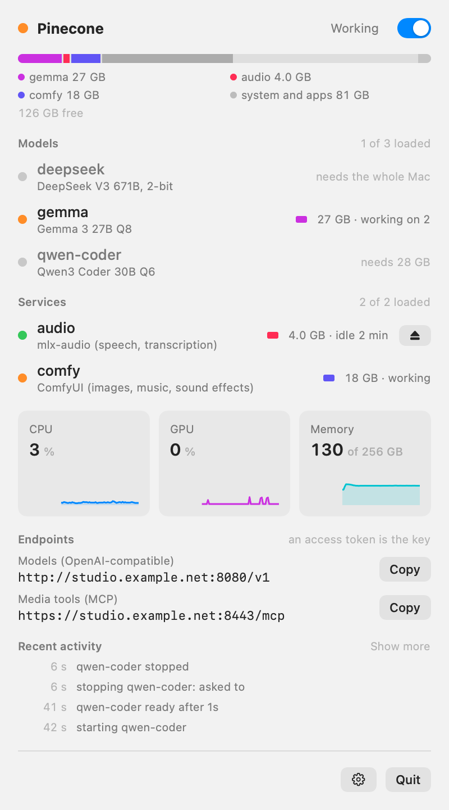

<h1 align="center">
  <picture>
    <source media="(prefers-color-scheme: dark)" srcset="docs/images/logo-dark.svg">
    
  </picture>
</h1>

Run more local AI than fits into your Mac's memory at once.

<p align="center">
  <picture>
    <source media="(prefers-color-scheme: dark)" srcset="docs/images/panel-dark.png">
    
  </picture>
</p>

### The problem

With a chat model, a coding model, an image generator and a speech model on one machine, something is always in
the way of something else, and you end up starting and stopping servers by hand.

### What Pinecone does

- **You say what the system keeps, not what a model gets.** And by default it pins the OS to a bare minimum and raises the Mac's GPU memory limit to match. Everything else belongs to models.
- **It loads and unloads for you.** A request for a model that is not in memory starts it. If it does not fit,
  whatever is idle goes first. A request waits while that happens; nothing that is working is ever stopped.
- **It is made for tight machines.** One large model that needs the whole Mac, or a bundle of smaller ones
  side by side, or both in turn: the space you gave it is never exceeded.
- **Services become MCP tools automatically.** Image gen, music and speech servers are not chat models, so Pinecone wraps them into
  a MCP server that describes what they can do. You give this URL to your agent and it will be able to handle all your assets.

That leaves a client with two addresses, both shown in the menu bar app:

| Endpoint | For |
|---|---|
| `http://your-mac:8080/v1` | Models, as an OpenAI-compatible API. The `model` in a request picks one. |
| `http://your-mac:8090/mcp` | Tools, as an MCP server: make an image, edit a photo, compose music, speak, transcribe. |

### Start

```bash
git clone https://github.com/pmndrs/pinecone && cd pinecone
python3 -m venv .venv && .venv/bin/pip install -r requirements.txt
.venv/bin/python scheduler/scheduler.py
```

The first start makes `~/.pinecone/config.json`. Put your models in, or hand the file and
[the docs](docs/configuration.md) to your coding agent:

```json
{
  "system_reserve_gb": 8,
  "resources": {
    "gemma": {
      "title": "Gemma 3 27B",
      "memory_gb": 30,
      "port": 8101,
      "cmd": ["$LLAMA_SERVER", "-m", "$MODELS/gemma-3-27b.gguf", "--port", "$PORT"]
    }
  }
}
```

Pinecone downloads no models and brings no inference engine. It runs the servers you already use
(llama.cpp, ComfyUI, mlx-audio, anything that listens on a port) and decides when to load or unload them.

### Documentation

- [Setup](docs/setup.md): the scheduler, media server, menu bar app, starting at login
- [Configuration](docs/configuration.md): settings, variables, how it decides what to unload
- [Media tools](docs/tools.md): describing tools in the config, and how files travel
- [Clients](docs/clients.md): our two endpoints, access tokens, pine and other clients
- [API](docs/api.md) · [The app](docs/app.md) · [Operations](docs/operations.md)
