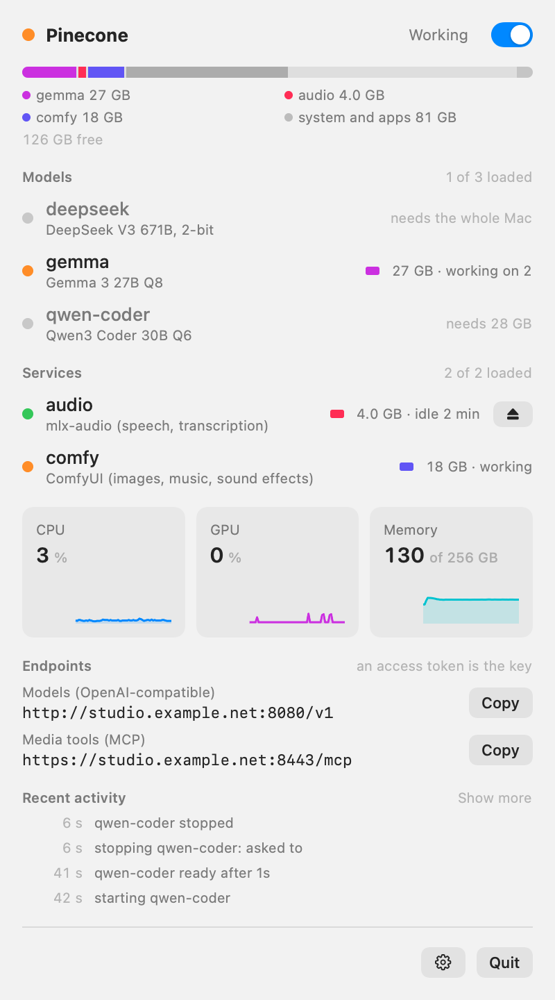
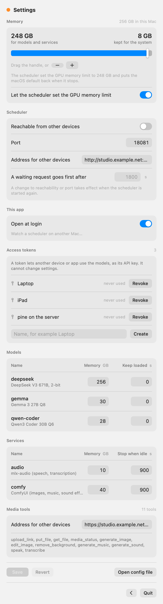

# The menu bar app

[Setup](setup.md) · [Configuration](configuration.md) · [Media tools](tools.md) · [Clients](clients.md) · [API](api.md) · [The app](app.md) · [Operations](operations.md)

Pinecone.app shows what the scheduler is doing and holds the settings that are yours to decide.

  <picture>
    <source media="(prefers-color-scheme: dark)" srcset="images/panel-dark.png">
    
  </picture>
  <picture>
    <source media="(prefers-color-scheme: dark)" srcset="images/settings-dark.png">
    
  </picture>

menubar/build.sh                                   # needs only the Xcode Command Line Tools
    cp -R menubar/build/Pinecone.app /Applications/

The icon is faded while the scheduler is off and shows a dot while something is loading or working. The
panel lists models and services with their state and memory, a memory bar split by what is loaded, what
is waiting, CPU, GPU and memory graphs, the endpoints to give to clients (with a button to copy each),
and recent activity. The switch at the top starts and stops the background services installed by
`launchd/install.sh`.

Settings hold what is the user's to decide on this Mac: the memory split and whether the scheduler sets the
GPU memory limit, whether and where other devices reach it, access tokens, and for each model and service
its planned memory and how long it stays loaded. Save sends what changed to the scheduler, which writes it
into `config.json` and applies it. What sets a model or a tool up (start commands, paths, ports, model
files, the tools themselves) is not in Settings: that is edited in the file, by you or by an AI agent.

The app keeps no list of models. Everything it shows comes from `/scheduler/status`. Pointed at a
scheduler on another Mac (Settings, Scheduler), it asks for an access token and shows status only.

`Pinecone --snapshot out.png [--settings] [--dark]` draws the panel into a picture and quits, for checking
design changes without clicking through the app.
